# QuizMaster — Online Examination & Assessment Management System

<div align="center">

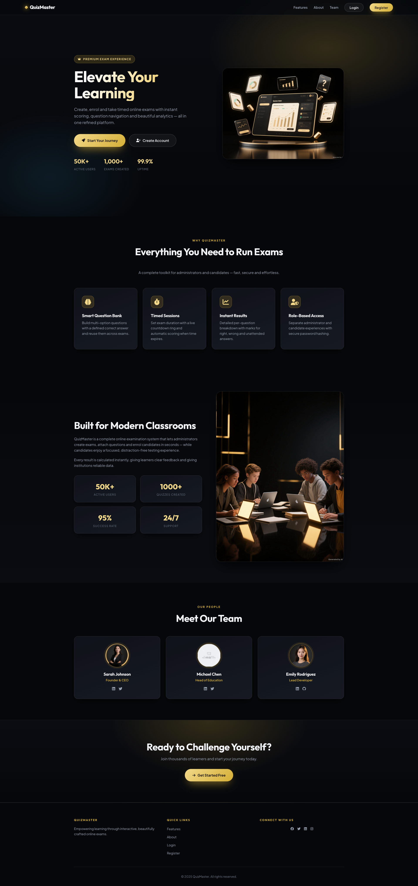

<br/>

[](https://www.php.net/)
[](https://www.mysql.com/)
[](https://en.wikipedia.org/wiki/Model%E2%80%93view%E2%80%93controller)
[](Assets/CSS/style.css)
[](Controllers/User.php)
[](LICENSE)

<br/>

**A modern, role-based web examination platform built with PHP and MySQL, featuring custom timed tests, automated scoring, question banking, and a sleek dark-gold aesthetic.**

[Live Walkthrough](#-page-showcase--ui-walkthrough) • [Key Features](#-key-features) • [System Architecture](#-system-architecture) • [Database Schema](#-database-schema) • [Installation Guide](#-installation--setup) • [Academic Info](#-academic-supervision--credits)

</div>

---

## 📌 Executive Summary

**QuizMaster** is an end-to-end web-based examination platform developed as a semester project for the **Web Technologies** course at **American International University-Bangladesh (AIUB)**. The system is architected to streamline academic evaluations by providing instructors and administrators with complete oversight over examinations, question banks, and candidate registrations, while providing students with a clean, distraction-free environment for timed multiple-choice assessments with real-time scoring.

The platform follows a clean **Model-View-Controller (MVC)** design pattern, implements secure authentication using **BCrypt** hashing, leverages MySQLi prepared statements to prevent SQL injection, and uses an ultra-premium dark theme with responsive CSS.

---

## 👨‍🏫 Academic Supervision & Credits

This project was developed under the academic guidance and supervision of:

<br/>

<div align="center">

| Course Instructor | Academic Information |
| :---: | :--- |
| <br/>**MD. AL-AMIN**<br/><sub>Assistant Professor / Lecturer</sub> | **Institution:** American International University-Bangladesh (AIUB)<br/>**Faculty:** Faculty of Science & Information Technology (FSIT)<br/>**Course:** Web Technologies [Section F]<br/>**Semester:** Spring 2024-25<br/>**Email:** [`alamin@aiub.edu`](mailto:alamin@aiub.edu) |

</div>

<br/>

### 👨‍💻 Project Developer
- **Name:** Md. Jahin Khan Utsho
- **Institution:** American International University-Bangladesh (AIUB)
- **Email:** [`jutsho2@gmail.com`](mailto:jutsho2@gmail.com)
- **GitHub:** [@castleofprinces](https://github.com/castleofprinces)

---

## 📸 Page Showcase & UI Walkthrough

Every page of the **QuizMaster** platform has been custom-styled with a cohesive, dark-themed glassmorphism visual language, responsive layout grids, and interactive states.

---

### 1. Modern Landing Page
The public landing page introduces candidates and educators to QuizMaster. It includes a dynamic hero section with statistical counter callouts, key features grid, an institution-focused about section, a team showcase, and smooth action triggers for signing in or registering.

<div align="center">
  
</div>

<br/>

---

### 2. Authentication & Access Control

The platform provides dual-role access control for **Administrators** and **Candidates (Students)** with dedicated session initialization and server-side validation.

#### A. Secure Sign In Page
Users select their account role (`Admin` or `User`), enter their credentials, and are directed to their corresponding role-tailored dashboard. Passwords are electronically verified via PHP `password_verify()` against salted BCrypt hashes.

<div align="center">
  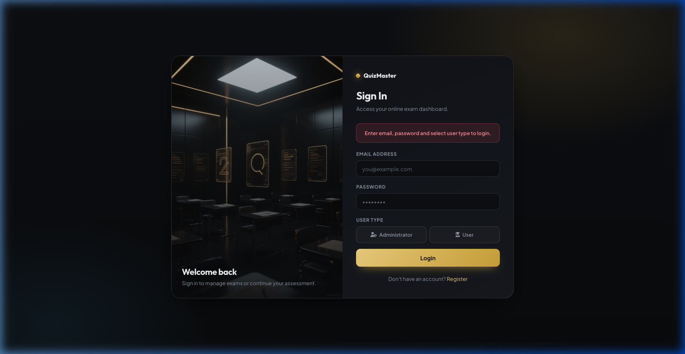
</div>

<br/>

#### B. Candidate Registration Page
New students can self-register with their academic and personal details (Full Name, Gender, Email, Mobile Number, Residential Address, and Password).

<div align="center">
  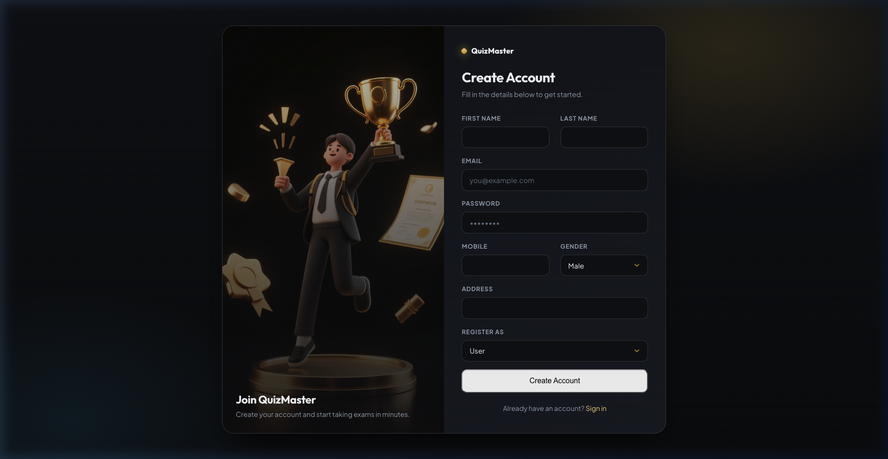
</div>

<br/>

---

### 3. Administrator Portal

Administrators have comprehensive control over examinations, multiple-choice questions, enrolled students, and system accounts.

#### A. Exam Management Dashboard
Administrators can create new exams, adjust test duration (in minutes), configure total question count, specify positive marks per correct response, set negative marking penalties, and toggle active exam statuses. Includes real-time DataTables pagination and search filtering.

<div align="center">
  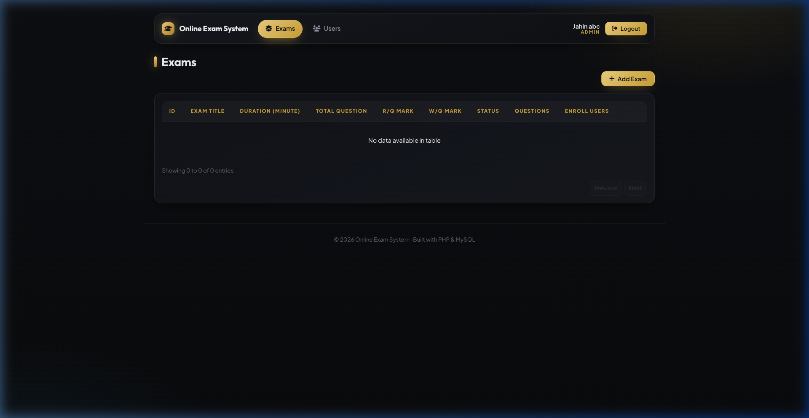
</div>

<br/>

#### B. Question Bank & Options Management
Manage question banks linked to individual exams. Each question supports four dynamic answer options, a designated correct answer key, and edit/delete controls with instant AJAX reloading.

<div align="center">
  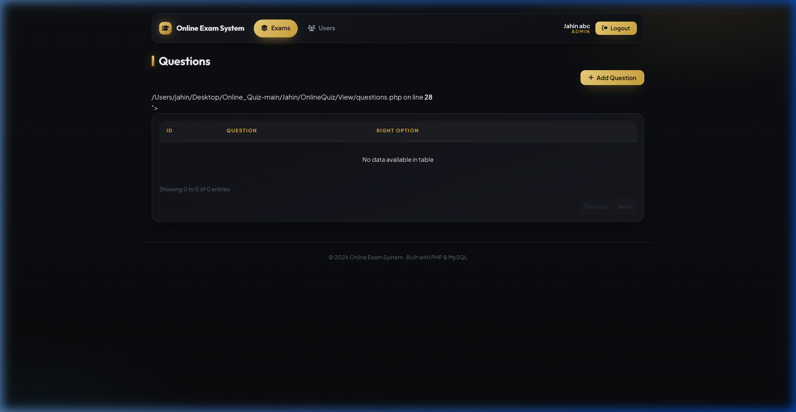
</div>

<br/>

#### C. Candidate Enrollment Monitoring
Administrators can audit candidates enrolled in any specific examination, monitor attendance status (`Present` / `Absent`), and track student test participation.

<div align="center">
  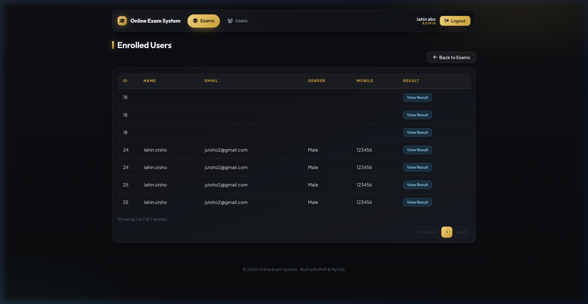
</div>

<br/>

#### D. User Account Administration
Provides a complete roster of system users, displaying account identifiers, contact information, role badges (`Admin` vs `Member`), and modification controls.

<div align="center">
  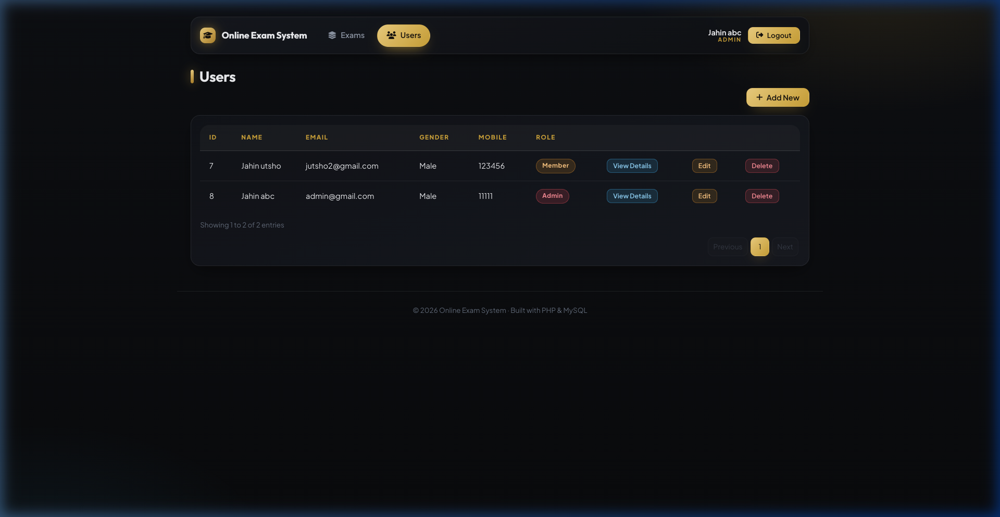
</div>

<br/>

#### E. Administrative User Creation Modal
Modal window for adding users directly from the administration dashboard with immediate role assignment and encrypted password generation.

<div align="center">
  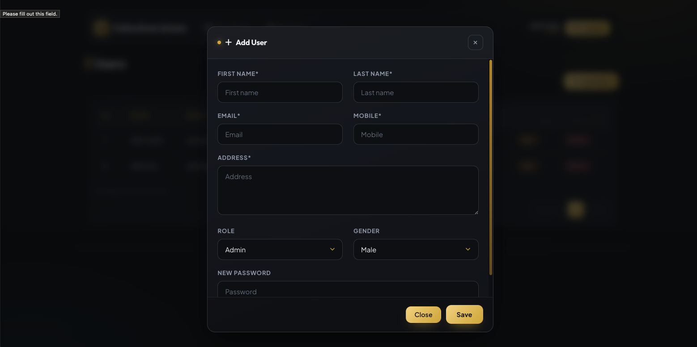
</div>

<br/>

---

### 4. Candidate (Student) Portal

#### A. Exam Enrollment Selection
Students browse available institutional examinations from a categorized dropdown and enroll in upcoming tests with a single click.

<div align="center">
  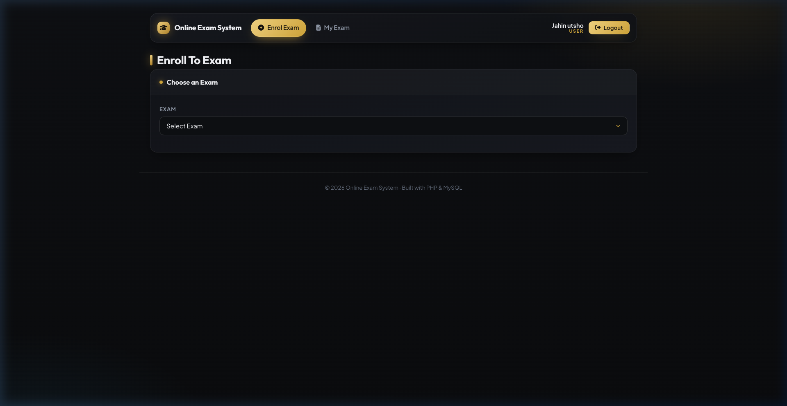
</div>

<br/>

#### B. "My Exams" Candidate Dashboard
Students can review all enrolled examinations, test durations, question allotments, grading schemes (right mark vs. wrong penalty), and attendance statuses.

<div align="center">
  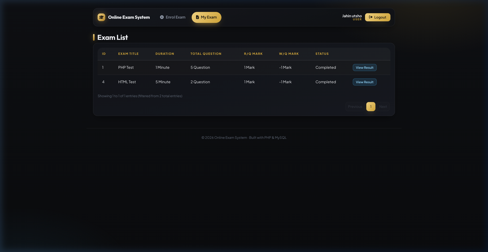
</div>

<br/>

#### C. Live Assessment & Result Tracking
Candidates launch the timed examination interface equipped with live countdown timers, question-by-question navigation, state persistence, and instant post-submission score reports.

<div align="center">
  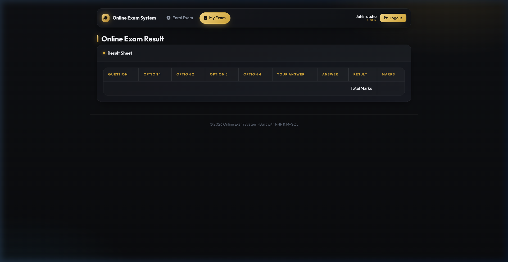
</div>

---

## 🌟 Key Features

### 👑 Administrator Capabilities
- **Exam Builder**: Create, update, and manage exams with custom titles, start times, and test durations.
- **Scoring Customization**: Define custom points for correct answers and apply negative deductions for incorrect attempts.
- **Smart Question Bank**: Attach questions to exams, specify 4 options per question, and define the correct answer key.
- **Enrollment Oversight**: Track student registrations per examination and review real-time attendance.
- **User Directory**: View registered candidates, assign administrative privileges, and edit user profiles.

### 🎓 Candidate (Student) Capabilities
- **Effortless Self-Service**: Register, authenticate, and manage profile information.
- **One-Click Enrollment**: Select tests across subjects (PHP, JavaScript, HTML, Python, etc.) and register instantly.
- **Timed Examination Session**: Live countdown clock powered by TimeCircles that triggers auto-submission upon expiry.
- **Interactive Question Navigation**: Seamlessly transition across questions, review selections, and modify answers prior to submission.
- **Instant Automated Grading**: Immediate calculation of final marks based on positive scoring and negative deductions.

---

## 🏛 System Architecture

The application is structured using the **Model-View-Controller (MVC)** architectural pattern to ensure loose coupling, code reusability, and clean separation of concerns:

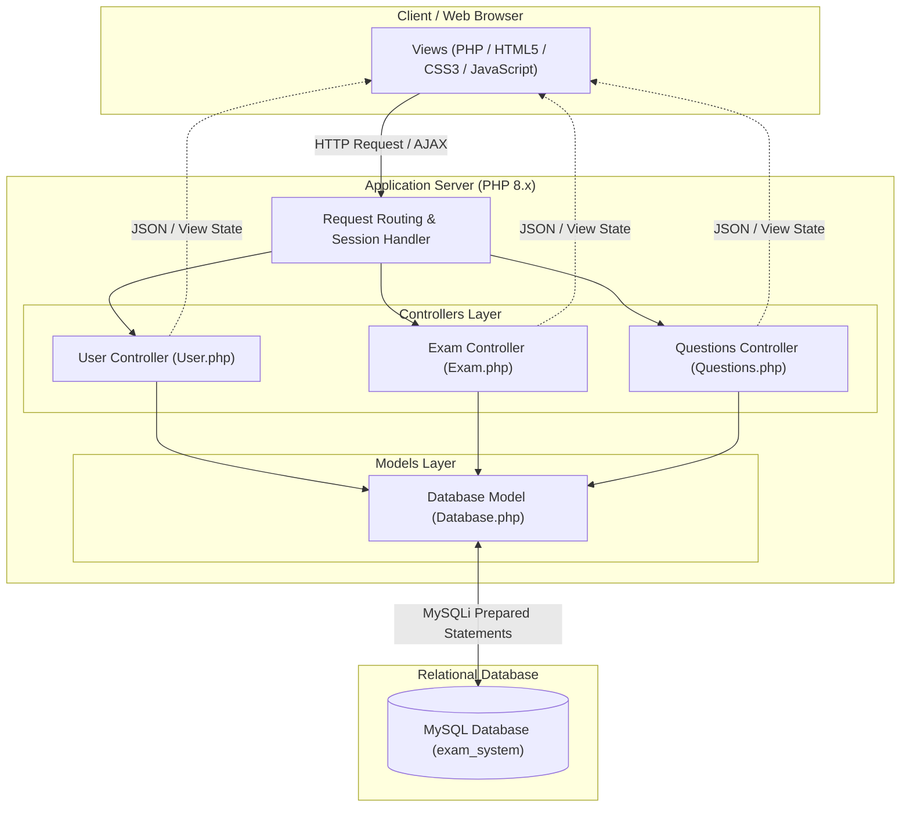

### 📂 Directory Structure

```plaintext
OnlineQuiz/
├── Assets/                        # Static presentation assets
│   ├── CSS/
│   │   └── style.css              # Custom dark-gold design system
│   ├── images/
│   │   ├── documentation/         # Documentation screenshots & instructor portrait
│   │   └── *.svg                  # UI illustrations and vector icons
│   └── js/
│       ├── exam.js                # Admin exam management AJAX handlers
│       ├── questions.js           # Admin question bank logic
│       ├── user.js                # User management handlers
│       ├── user_exam.js           # Candidate examination interactions
│       ├── TimeCircles.js         # Canvas countdown timer library
│       └── jquery.dataTables.min.js
├── Controllers/                   # MVC Application Business Logic
│   ├── Exam.php                   # Exam lifecycle, scoring, and evaluations
│   ├── Questions.php              # MCQ questions and options CRUD operations
│   └── User.php                   # Authentication, sessions, and profile management
├── Models/                        # Data Layer
│   ├── Database.php               # MySQLi persistent database connection
│   └── exam_system.sql            # Complete relational database dump
├── View/                          # Presentation Layer (Views)
│   ├── index.html                 # Public landing page
│   ├── login.php                  # Authentication gateway
│   ├── register.php               # Student account onboarding
│   ├── exam.php                   # Admin: Exam management dashboard
│   ├── questions.php              # Admin: Question bank dashboard
│   ├── user.php                   # Admin: User management dashboard
│   ├── enroll.php                 # Admin: Exam enrollment review
│   ├── view_exam.php              # Candidate: Registered exams list
│   ├── enroll_exam.php            # Candidate: Exam registration interface
│   ├── process_exam.php           # Candidate: Interactive exam session
│   ├── view_result.php            # Candidate: Detailed performance results
│   └── top_menus.php              # Shared role-aware navigation bar
└── inc/                           # Modular Layout Components
    ├── header.php                 # Shared HTML head, meta tags, and CSS includes
    ├── container.php              # Dynamic content wrapper
    └── footer.php                 # Shared scripts and closing tags
```

---

## 🗄 Database Schema

The platform relies on a normalized relational database schema (`exam_system`) consisting of 6 core tables:

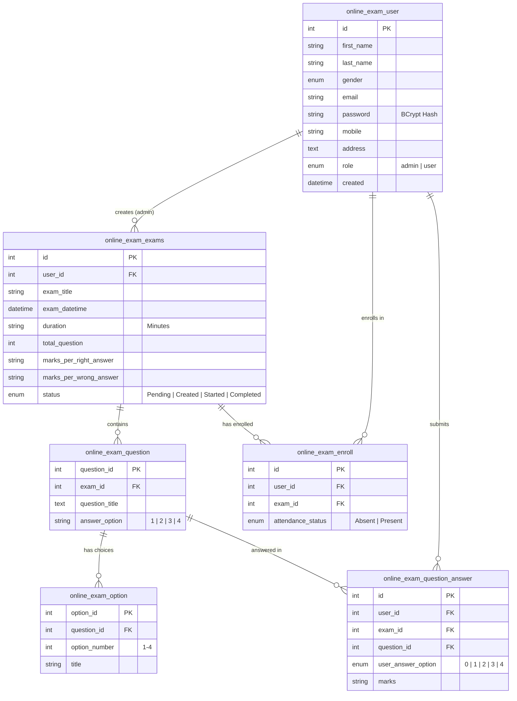

### Table Breakdown

| Table Name | Description | Key Fields |
| :--- | :--- | :--- |
| `online_exam_user` | User credentials, roles, and personal profiles | `id`, `email`, `password`, `role` |
| `online_exam_exams` | Exam configurations, time limits, and scoring parameters | `id`, `exam_title`, `duration`, `marks_per_right_answer`, `marks_per_wrong_answer` |
| `online_exam_question` | Individual test questions linked to specific exams | `question_id`, `exam_id`, `question_title`, `answer_option` |
| `online_exam_option` | 4 answer choices associated with each question | `option_id`, `question_id`, `option_number`, `title` |
| `online_exam_enroll` | Records candidate registration for exams | `id`, `user_id`, `exam_id`, `attendance_status` |
| `online_exam_question_answer` | Logs submitted candidate responses and marks | `id`, `user_id`, `exam_id`, `question_id`, `user_answer_option`, `marks` |

---

## 🔒 Security & Best Practices

- **Password Cryptography**: All passwords stored in `online_exam_user` are hashed using PHP's native `password_hash()` utilizing the **BCRYPT** algorithm with automatic salting.
- **SQL Injection Prevention**: Database interactions use **MySQLi parameterized prepared statements** (`$stmt->prepare()` and `$stmt->bind_param()`), mitigating SQL injection vectors.
- **Role-Based Access Control (RBAC)**: Controllers and views inspect active session variables (`$_SESSION["role"]`) to enforce strict authorization checks between candidate and administrator capabilities.
- **Input Sanitization**: Form variables are filtered and validated to prevent Cross-Site Scripting (XSS).

---

## 🚀 Installation & Setup

Follow these instructions to configure and run the project locally on your development machine.

### Prerequisites
- **Web Server**: Apache or Nginx (or PHP built-in CLI server)
- **PHP**: Version 8.0 or higher with `mysqli` extension enabled
- **Database Server**: MySQL 5.7+ or MariaDB 10.4+
- **Tooling**: [XAMPP](https://www.apachefriends.org/), [MAMP](https://www.mamp.info/), or native PHP/MySQL

---

### Step 1: Clone or Download the Repository
```bash
git clone https://github.com/castleofprinces/Online_Quiz.git
cd Online_Quiz/Jahin/OnlineQuiz
```

---

### Step 2: Database Setup
1. Launch your MySQL server (via XAMPP Control Panel, MySQL CLI, or GUI client like phpMyAdmin).
2. Create a new database named `exam_system`:
   ```sql
   CREATE DATABASE exam_system;
   ```
3. Import the provided schema file located at [`Models/exam_system.sql`](Models/exam_system.sql):
   ```bash
   mysql -u root -p exam_system < Models/exam_system.sql
   ```
   *(Or import via phpMyAdmin by selecting `exam_system` -> `Import` -> browse to `Models/exam_system.sql`).*

---

### Step 3: Configure Database Credentials
Open [`Models/Database.php`](Models/Database.php) and verify your local database connection parameters:

```php
private $host     = 'localhost';
private $user     = 'root';
private $password = '';              // Set your MySQL password if configured
private $database = 'exam_system';
```

---

### Step 4: Run the Application

#### Option A: Using PHP Built-In Server (Recommended for Fast Setup)
From the root of the project directory (`OnlineQuiz/`), launch:
```bash
php -S localhost:8000
```
Then navigate to:
- **Landing Page**: [http://localhost:8000/View/index.html](http://localhost:8000/View/index.html)
- **Login Portal**: [http://localhost:8000/View/login.php](http://localhost:8000/View/login.php)

#### Option B: Using XAMPP / MAMP
1. Copy the `OnlineQuiz` directory into your web server document root:
   - **XAMPP (macOS)**: `/Applications/XAMPP/xamppfiles/htdocs/OnlineQuiz`
   - **XAMPP (Windows)**: `C:\xampp\htdocs\OnlineQuiz`
2. Start Apache and MySQL from the XAMPP Control Panel.
3. Open your browser and navigate to:
   - [http://localhost/OnlineQuiz/View/index.html](http://localhost/OnlineQuiz/View/index.html)

---

### Step 5: Default User Credentials

You can use the pre-configured accounts in the database to test the platform:

| Role | Email | Password | Access Level |
| :--- | :--- | :--- | :--- |
| **Administrator** | `admin@gmail.com` | `123456` | Full exam, question, user, and enrollment administration |
| **Candidate / Student** | `jutsho2@gmail.com` | `123456` | Enroll in tests, take exams, and view grades |

---

## 🛠 Tech Stack

| Component | Technology | Description |
| :--- | :--- | :--- |
| **Backend Language** | PHP 8.x | Object-Oriented server logic and controller handlers |
| **Database** | MySQL / MariaDB | Relational storage for exams, questions, and users |
| **Frontend Layout** | HTML5 & Vanilla CSS3 | Custom dark-gold theme with responsive CSS Grid/Flexbox |
| **Client Scripting** | JavaScript / jQuery | Asynchronous AJAX workflows, modal controls, and events |
| **Data Tables** | DataTables.js | Client-side sorting, searching, and pagination |
| **Exam Countdown** | TimeCircles.js | Live circular timer for timed exam enforcement |
| **Iconography** | FontAwesome 6 | Vector iconography for navigation and UI elements |

---

## 📄 License

This project is licensed under the [MIT License](LICENSE) — feel free to use and adapt this project for educational and learning purposes.

---

<div align="center">
  <sub>Developed with ❤️ by <b>Md. Jahin Khan Utsho</b> • Supervised by <b>MD. AL-AMIN</b> • American International University-Bangladesh (AIUB)</sub>
</div>